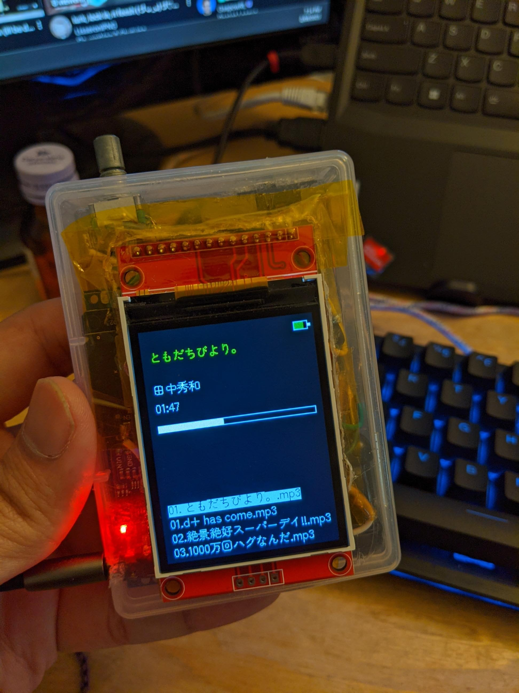
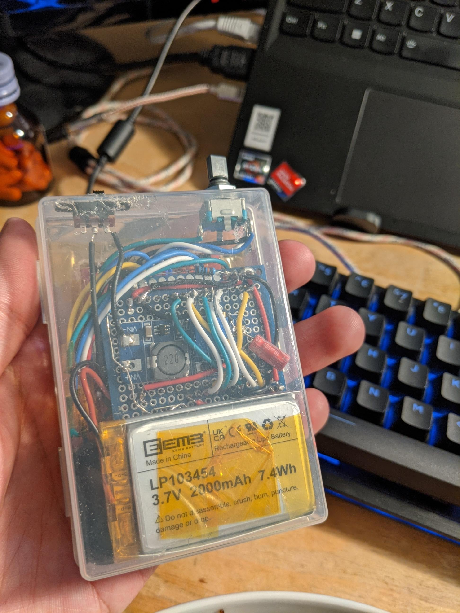

# ESP32 Music Player

A simple portable music player built with an ESP32, inspired by classic iPods and MP3 Players.  
This project was a way to explore I²S audio and the [ESP32-audioI2S](https://github.com/schreibfaul1/ESP32-audioI2S) library.

---

## Demo Video

---

## Hardware Used
- ESP32  
- PCM5102 DAC  
- TFT Screen (ST7789)  
- 2000mAh Li-Po Battery  
- TP4056 charger  
- MT3608 boost module
- 2x 1N5817 diodes  
- SPDT switch  
- Encoder with button
- 100k & 47k resistor for voltage divider
- SD card slot
---

## Controls
| Action | Now Playing | Browse list |
|---|---|---|
| Rotate | Volume | Move cursor |
| Click | Play / pause | Play selected song |
| Hold + rotate | Next / previous track (prev restarts song if >3 s in) | Fast scroll |
| Long press (0.7 s) | Open browse list | Close list |
| Hold at power-on | Force library rescan | |

Screen dims after 10 s and sleeps after 30 s. Paused for 10 min with the screen off -> deep sleep; press the knob to wake and resume where you left off.

## Firmware layout
| File | Role |
|---|---|
| `include/Config.h` | All pins and tunables |
| `Player` | Audio task on core 0, command queue, NVS resume (track, position, volume) |
| `MusicLibrary` | Song index on SD with in-RAM line offsets (O(1) lookup) |
| `Input` | Quadrature state-machine encoder ISR + button click/long-press FSM |
| `Ui` | Diff-based TFT drawing, browse list, dim/sleep |
| `Battery` | Calibrated ADC, LiPo curve |

TFT pins (CS 15, DC 2, RST -> EN, BL) are set in TFT_eSPI's `User_Setup.h` — see the note in `platformio.ini`.

### Japanese font in flash (recommended)
Copy the `.vlw` from the SD card's `/fonts` folder to your PC and run
`python tools/vlw_to_header.py ZenMaruGothic-Regular-16-minJap-noSmooth.vlw`.
This creates `include/font_jp.h`; the firmware then stops reading glyphs from the SD card.

## Features
- Play music via I²S using the ESP32
	- supports .mp3 and .wav
- TFT screen for user interface
	- Metadata taken from mp3 file
	- Batter indicator
- Rechargeable Li-Po battery power  
- Custom font to support Japanese characters
- Auto-scan music folder from SD card

---

## Project Goals
- Learn the basics of I²S on ESP32  
- Create a standalone portable music player  
- Experiment with audio libraries and embedded UI  

---

## Images
  
  

---

## Future Improvements
- Better enclosure 
- Integrate to PCB
- Revise on the controls
- Upgrade to ESP32-S3 for FLAC support
